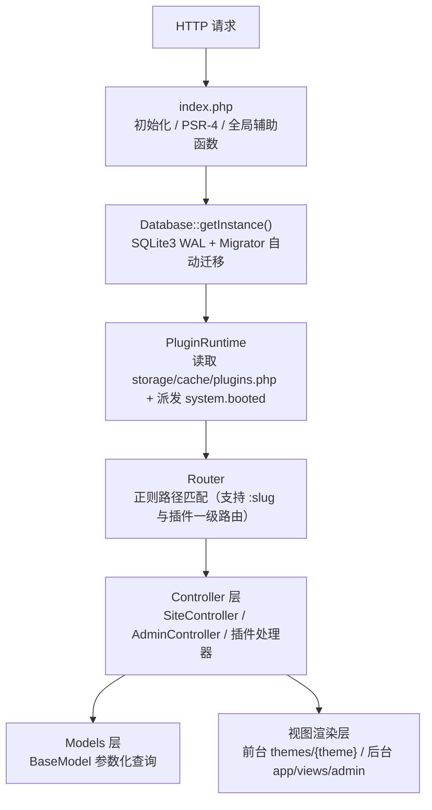

# SHOPAGG CMS 系统架构

> **归属仓库**：`shopagg-b2b-website`（v1.x，当前稳定版 `v1.3.6`）
> **适用范围**：后端研发、架构师与 AI 助手；修改核心路由、数据库迁移、主题引擎或插件运行时前阅读。
> **相关文档**：[后台使用指南](admin-guide.md) · [模板开发指南](theme-development.md) · [插件开发指南](plugin-development.md) · [插件规范](plugin-specification.md)

---

## 1. 定位与生态边界

**SHOPAGG CMS** 是面向中国工厂与外贸企业的开源 B2B 官网系统，采用零框架依赖的纯 PHP + SQLite3 实现，既支持通过 `shopagg-host-manager` 托管部署，也支持独立自托管。

| 相关项目 | 角色 | 边界 |
| --- | --- | --- |
| `shopagg-b2b-website` | **SHOPAGG CMS v1.x 核心**（当前 `v1.3.6`） | 生产现役代码、主题、Plugin API 1.0 |
| `shopagg.org` | SHOPAGG CMS 官网（Astro 静态站） | 发布公开使用/开发文档与构建期版本 JSON |
| `shopagg-update-server` | 独立更新服务（`update.shopagg.org`） | Cloudflare Worker 代理 GitHub Releases，与主平台隔离 |
| `Lighthouse-CMS-2.0` | 新一代开源预览版（`2.0.0-alpha.1`） | Astro 7 + Cloudflare Workers/D1/R2/KV，尚在开发预览期，不替代 v1.x 生产托管 |

---

## 2. 技术栈与运行环境

| 层次 | 技术实现 | 说明 |
| --- | --- | --- |
| PHP 运行时 | PHP 8.1+ | 必需扩展：`sqlite3`、`mbstring`、`fileinfo`；不依赖 Composer |
| 数据存储 | SQLite3（WAL 模式） | 单站单库 `storage/site.db`，`PRAGMA foreign_keys = ON`，忙超时 `5000ms` |
| Web 服务器 | Nginx（托管版由 Host Manager 独立 sidecar 管理）或 Apache | 需要 URL 重写指向 `index.php` |
| 前台样式与组件 | Tailwind CSS CDN、Font Awesome、Swiper.js | 无需前端构建管线即可部署主题 |
| 后台交互 | Jodit 富文本编辑器、SortableJS 拖拽排序 | 后台视图位于 `app/views/admin/` |

---

## 3. 核心目录结构

```text
shopagg-b2b-website/
├── index.php                  # 唯一入口：定义 APP_VERSION、PSR-4 自动加载、触发迁移与路由分发
├── shopagg                    # CLI 工具（plugin:make / validate / pack / test / jobs / rollback 等）
├── app/
│   ├── Core/                  # Router、Controller、Database、Migrator、AuthManager、MediaManager
│   ├── Controllers/           # BaseController、SiteController、AdminController
│   ├── Models/                # BaseModel、User、Setting、Product、PostModel、Category、Inquiry、Message、Slider、Menu、Updater 等
│   ├── Helpers/               # Helpers.php（模板全局函数）、SecurityHelper.php
│   ├── Migrations/            # 按时间戳排序的版本化 SQLite 迁移文件
│   ├── Plugins/               # PluginRuntime、PluginManifest、PluginSchema、Contracts、DTO、Exceptions
│   ├── views/admin/           # 后台界面模板与统一布局 layout.php
│   └── routes.php             # 集中路由表
├── themes/                    # 前台主题目录（默认 themes/default/）
├── assets/admin/              # 后台静态资源
├── storage/                   # 禁止 Web 直接访问：site.db、blocks/、plugins/、cache/plugins.php、backups/、logs/
├── uploads/                   # 按 YYYYMM 分目录的上传媒体（含防列目录规则）
└── docs/                      # 仓库内开发与使用文档
```

---

## 4. 请求生命周期与分层



- **正常请求零目录扫描**：插件元数据在启用、停用、升级、回滚时编译写入 `storage/cache/plugins.php`，正常请求直接读取缓存。
- **自动迁移**：首次访问或升级后由 `Migrator::runAllPending()` 顺序执行未落库的迁移并写入 `migrations` 表。

---

## 5. 核心模块与数据模型

### 5.1 核心表概览

| 业务域 | 核心表 | 关键设计 |
| --- | --- | --- |
| 账号与设置 | `users`、`settings`、`migrations`、`update_logs` | `users` 支持 `admin` / `staff` 角色与模块级权限；`settings` 为全站 KV 配置 |
| 产品与商品 | `products`、`product_categories`、`product_prices`、`product_skus` | 支持多级分类、四种价格模式（含区间价/阶梯价）、多规格 SKU 与软删除（`deleted_at`） |
| 内容与媒体 | `posts`、`media_files` | `posts` 以 `post_type`（`post`/`case`/`page`）统一管理文章、案例与独立页；`media_files` 索引上传文件 |
| 询盘与留言 | `inquiries`、`messages` | 记录产品关联、数量、来源 URL、IP、User-Agent 与处理状态流转 |
| 外观与导航 | `sliders`、`slider_items`、`menus`、`menu_items` | 轮播图与多级导航菜单由数据库维护，区块覆盖值保存在 `storage/blocks/{theme}.php` |
| 扩展与商店 | `plugins`、插件任务表、`app_store_theme_installs` | 插件业务表统一强制 `p_{plugin_id}_*` 前缀；主题与插件支持版本更新与授权状态校验 |

### 5.2 认证与权限（`AuthManager`）

- 密码使用 bcrypt（`password_hash` / `password_verify`）。
- 角色分为 `admin`（全权）和 `staff`（按权限模块白名单授权：`products`、`cases`、`blog`、`inbox`、`settings`、`staff` 以及插件声明的 `plugin.{id}.{perm}`）。

### 5.3 主题与区块机制

- 前台视图顺序加载：`themes/{theme}/functions.php` → `header.php` → `{view}.php` → `footer.php`（主题不存在时回退 `default`）。
- 区块配置采用“主题 `blocks.php` 默认值 + `storage/blocks/{theme}.php` 用户覆盖值”合并模式，通过 `block()` / `block_all()` 读取。详见[模板开发指南](theme-development.md)。

### 5.4 Plugin API 1.0

- 进程内 PHP 插件系统，通过 `plugin.json` Manifest 声明路由、事件、过滤器、插槽、服务契约（`provides_services` / `requires_services`）、分片/周期任务、后台菜单与权限，由 `app/Plugins/PluginManifest.php` 校验。
- 静态资源与插件代码分别存放于固定版本化目录与受保护 `storage/plugins/`，脱离 `uploads/` 目录。详见[插件开发指南](plugin-development.md)与[插件规范](plugin-specification.md)。

---

## 6. 安全架构

| 安全维度 | 实现要求 |
| --- | --- |
| XSS 防护 | 模板输出一律使用 `h()` 转义；URL 使用 `url()` / `asset_url()` |
| SQL 注入防护 | 模型层基于 `BaseModel` 预处理语句与参数绑定 |
| CSRF 防护 | 所有后台写操作与插件写路由校验 `csrf_token()` / `csrf_check()` 或 `csrf` 中间件 |
| 文件上传安全 | `MediaManager` 校验真实 MIME、扩展名与体积上限；`uploads/` 禁止脚本执行与列目录 |
| 目录保护 | `storage/`（含 `site.db` 与插件 PHP 源码）严禁经由 Web 直接访问 |
| 多租户隔离（托管版） | 由 `shopagg-host-manager` 为每站提供独立 Linux UID、PHP-FPM、Nginx、配额与 AppArmor 边界 |

---

## 7. 本地预览与更新

本机快速预览（仅用于开发调试，正式托管站由 Host Manager 部署）：

```bash
php -S 127.0.0.1:8000
```

程序更新通过独立更新服务 `update.shopagg.org`（代理 GitHub Releases）检查与下载，更新前自动执行备份与迁移检查。
